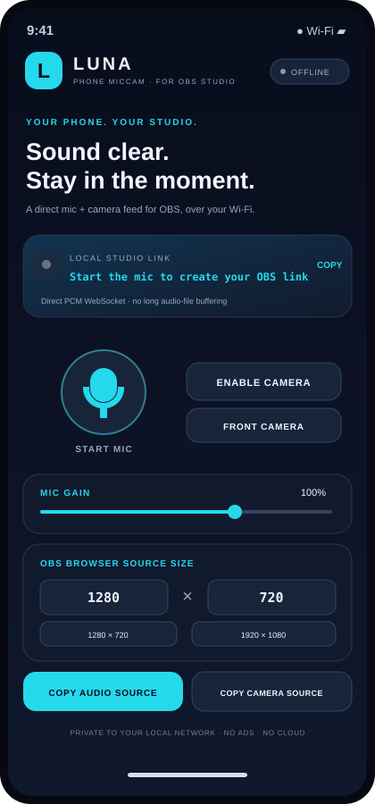
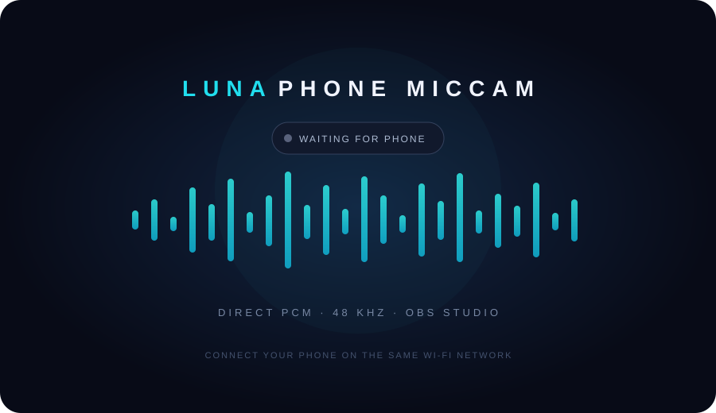
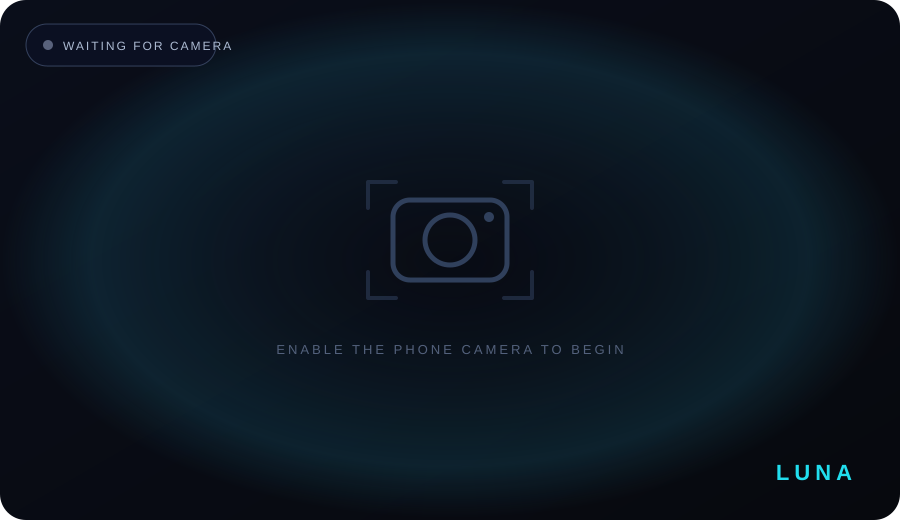

# Luna Phone MicCam

  

<h3 align="center">Your phone, on your OBS scene.</h3>

Turn an Android phone into a local Wi-Fi microphone and camera source for OBS Studio.

  
  
  
  

---

## App previews

These static previews are drawn from the current Android and OBS page source. They illustrate the real interface and idle states; they are not captures from a connected Android device.

  
  &nbsp;
  
  &nbsp;
  

## What it does

- **Live microphone:** streams mono 48 kHz PCM in short 10 ms packets to an OBS Browser Source over a direct WebSocket.
- **Phone camera:** sends a live MJPEG feed over your local network; choose the front or rear camera.
- **OBS-ready sizing:** enter a custom width and height, or choose 1280 × 720 / 1920 × 1080. The source URL carries those dimensions.
- **Mic gain:** adjust input gain from the phone while streaming.
- **Private by design:** the phone serves the feeds on your local network. No account, cloud relay, ads, or analytics are included.

> Keep Luna Phone MicCam open and the phone and computer on the same Wi-Fi network while streaming. Internet access is not used to relay audio or video.

## Install

Download [`LunaPhoneMicCam.apk`](LunaPhoneMicCam.apk), transfer it to your Android phone, and open it to install. The app supports Android 8.0 (API 26) and newer. Because this is a locally built APK, Android may ask you to allow installs from the app you opened it with.

The APK is debug-signed. Android identifies this renamed app separately from the earlier Luma/Phone-as-Mic package.

## Connect it to OBS

1. Put your phone and computer on the **same Wi-Fi network**. Avoid guest Wi-Fi or access-point isolation, which can block devices from reaching each other.
2. Open Luna Phone MicCam and tap **Start Mic**. Allow microphone access. The app starts a small web server and shows its local address.
3. Choose the desired OBS **width** and **height** in the app.
4. Tap **Copy Audio Source**. In OBS, add **Sources → + → Browser**, paste the copied URL, and use the same width and height values shown in Luna.
5. In the Browser Source properties, enable **Control audio via OBS**. Keep the source visible and unmuted.
6. If OBS asks for a browser audio gesture, right-click the source, choose **Interact**, then click **Start Audio**.

The app changes its status to **OBS Connected** when OBS opens the audio WebSocket. For a camera source, tap **Enable Camera**, select **Front Camera** or **Back Camera**, and add the URL copied with **Copy Camera Source** as a second Browser Source.

### Suggested source sizes

| Use | Width | Height |
| --- | ---: | ---: |
| Standard landscape | 1280 | 720 |
| Full HD landscape | 1920 | 1080 |

You can also enter custom dimensions in the app. Set the OBS Browser Source to those exact pixel values.

## Latency notes

Audio is captured as 48 kHz mono PCM and sent in short blocks; the browser schedules playback with a small bounded queue instead of waiting for a large audio file to buffer. Actual latency depends on the phone, Wi-Fi quality, and OBS/browser audio settings. For the best response, keep both devices on a strong 5 GHz network when available and close to the access point.

## Troubleshooting

- **OBS cannot open the URL:** confirm both devices are on the same Wi-Fi, the mic is running, and the phone screen/app has not been closed. Guest networks may prevent local connections.
- **No audio:** turn on **Control audio via OBS**, check that the source is unmuted in the OBS mixer, and use **Interact → Start Audio** if prompted.
- **Camera is blank:** start the mic stream first, then enable the camera and grant camera permission. Try switching front/back camera.
- **Source is cropped or soft:** match OBS Browser Source width and height to the values in the app; try 1920 × 1080 if the phone/network can keep up.
- **Audio is delayed or choppy:** use a stronger Wi-Fi signal, reduce competing network traffic, and try 1280 × 720 for video.

## License

No license has been declared yet. Contact me at talhasyed9080@gmail.com or at scizzeyyt@gmail.com if you want to edit or make any changes to this app or just email me and tell me what feature you want and I will try to add it.
